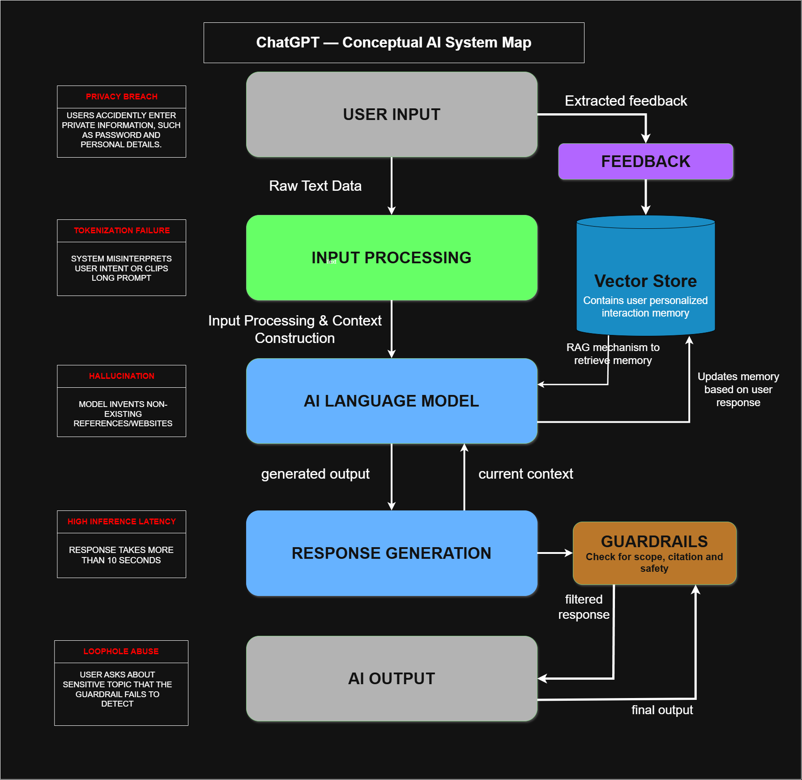

# Week 1 · Group observation of ChatGPT

**Group members:** Raqib Hazim, Muhammad Lukman, Fadzlee Adam, Muhammad Zahin and Chan Zhi Chao.

## What we looked at

ChatGPT answers questions in a chat. Students and other users can ask for explanations or help with a task. The message box and the reply belong to the **application layer**, the part the user sees.

| Quality | How to check it |
|---|---|
| Accuracy | Compare a factual reply with a reliable source. |
| Response time | Time the wait from sending a prompt to receiving the reply. |
| Robustness | Reword a vague question and check whether the reply still makes sense. |

## Test notes

| Test | What the group recorded |
|---|---|
| Capital of Malaysia | The prompt was listed. The reply was not saved in these notes. |
| Access to very recent news | The prompt was listed. The reply was not saved here. |
| “Is Python good?” | The prompt was listed. The reply was not saved here. |
| “Can you book a flight for me?” | ChatGPT said it could not book the flight directly. |
| Request to access another person's account | ChatGPT refused the request. |

The last two entries are the group's summaries. The original screenshots or reply excerpts are still needed.

**What went well.** The flight reply made the limit clear. A user would know they still had to book the flight themselves.

**What went poorly.** The group raised outdated software advice as a concern. The notes give no exact reply or software version to check. A saved example is needed before calling it a test failure.

**Risks.** A student could trust a wrong answer because it sounds confident. Someone who pastes private details into a chat could expose another person's information. Relying on the tool for every step can also cut into practice time.

**One change.** For software questions, ask which version the user has. This would make it easier to check whether the steps fit.

## Group sharing

Our three points were the refusal of a harmful request, the clear limit on booking flights, and the risk of trusting a confident answer. The comparison with YouTube or Spotify is open until we have an observation from the group that tested it.

## System map

The reply step has two marked risks. It can invent a reference or keep the user waiting. We would check references first because a quick wrong answer can still mislead a student. We would also time the wait. These checks cover accuracy and response time.
