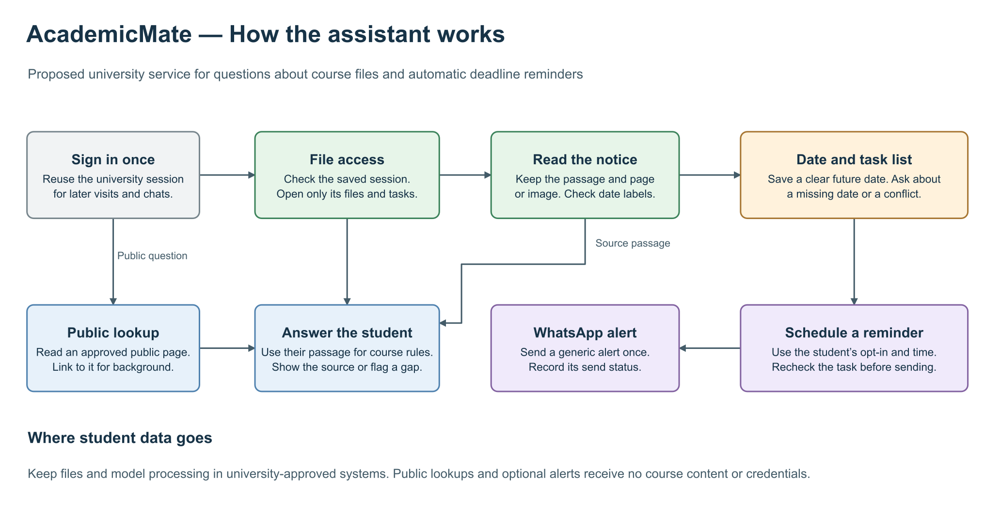

# Week 2 · AcademicMate design choices

## What the design needs

The simplest version takes a question and returns an answer. That leaves no way to check a date, save a task or send a reminder later.

| Rules | What is needed | Part of the design |
|---|---|---|
| FR1–FR3, RAI1 | Read the file under its owner’s account. Save clear dates automatically and flag unclear ones. | University sign-in, file reader and date check. |
| FR4, FR5, FR8, RAI2, RAI3 | Use the owner’s file for course questions. Keep public background separate and cite its URL. | File access check, answer tool and public lookup. |
| FR6 | Show the next ready task first. | Task calendar. |
| FR7, NFR4, RAI4 | After opt-in, send one generic alert using the student’s saved reminder time. | Reminder schedule and WhatsApp status. |

## Decisions and trade-offs

| Choice | Rules | Other option | Decision and cost |
|---|---|---|---|
| Get the notice | FR1, RAI3 | Connect directly to eLearning. | Keep the UTM session on the student’s device across visits. Check it in the background. Sign-out or expiry ends access. The student uploads the eLearning file and replaces it when it changes. |
| Save a date | FR2, FR3, RAI1 | Ask about every date. | Automatically save a clear future deadline and show its source. Hold an unclear or conflicting date for the student. |
| Answer a question | FR4, FR5, FR8, RAI2 | Answer from memory. | Use the owner’s file for course rules. For a separate public question, fetch an approved page and show its URL. Keep uploads, private prompts and credentials out of the request. |
| Send a reminder | FR7, NFR4, RAI4 | Send each time a task is checked. | Turn on reminders once. Recheck the date and opt-in before sending one generic alert. Cancel a pending alert if the date changes. |

## How we will check the design

| Goal | Rules | Test and target | Part of the design | Evidence to keep |
|---|---|---|---|---|
| O1 | FR2, NFR1 | At least 85 of 100 title and date fields match. | File reader | Expected and extracted values side by side. |
| O1 | FR3, RAI1 | Route all 20 dates correctly. No held date gets scheduled. | Date check | Expected and actual decision for each date. |
| O2 | FR4, FR5, FR8, NFR2, RAI2 | At least 24/30 answers correct. All 30 cite a source, at least 27 support the reply, and at least 18/20 missing answers are flagged. | Private file text and answer with source | Answer key, replies and cited lines. |
| O2 | FR6, NFR3 | At least 16/20 task lists in order. The 27th of 30 sorted reply times is under 5 seconds. | Calendar and answer with source | Expected order, actual order and reply times. |
| O3 | FR7, NFR4, RAI4 | At least 19/20 valid sends accepted on time. Zero duplicate, stale or unapproved sends in 20 further cases. | Reminder schedule and WhatsApp status | Task, chosen minute, send record and service reply for each test. |

**Biggest trade-off.** Automatic scheduling saves time, but a misread label can put the wrong date on the calendar. FR3 keeps the source visible and sends uncertain dates for review. Before a pilot, test the sign-in, file access, model and storage settings, and the exact content sent to public pages and WhatsApp.
