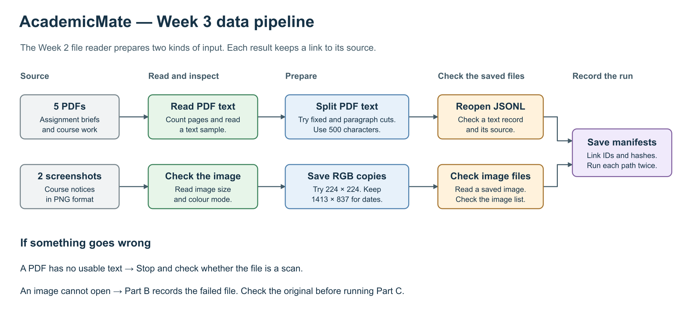

# Week 3 · Pipeline decisions

## What we chose

| Choice | What we found | What we kept |
|---|---|---|
| Split PDF text | Fixed cuts of 500 characters gave 109 pieces across five PDFs. Cutting at paragraph breaks gave 117. On the individual assignment, the counts were 10 and 11. | Use paragraph breaks to keep short instructions together for FR2. Long paragraphs can still split mid-word. The handout records the source file only. The [Week 4 follow-up](week4_data_quality_report.md) splits pieces at page breaks to support FR5. |
| Size the screenshots | In a separate reading check, the words “Opened” and “Due” could be read by OCR on both 1413 × 837 copies. It missed both labels on both 224 × 224 copies. | Keep 1413 × 837 RGB copies so a student can read the dates. Resizing stretches each screenshot slightly. The notebook saves images only. |
| Run a batch | The seven uploads are files we can read together. | Read the files, prepare them, then save the results (ETL). Rerun the batch when a notice changes. |
| Keep uploads private | A screenshot shows a submission status. Permission to publish the course files is unknown. | For RAI3, keep the inputs and prepared content local. Share file counts and hashes as evidence. |

## Checks

| Step | Check and response |
|---|---|
| Read | Find each named PDF and the image folder. Check the filenames against the seven in the inventory. Supply a missing file before rerunning. |
| Inspect | Count PDF pages and read a text sample. A PDF with no usable text needs a scan check. Open each screenshot and check its size and colour mode. |
| Prepare | Compare the two ways to split text and the two image sizes. Part B reports any image it cannot read. Check the failed file before accepting the batch. |
| Check outputs | Open a text record and a saved image. Check the output files exist and contain data. Correct the input or setting if a check fails. |
| Record and repeat | Match all seven inputs to outputs by file hash. Run each Part C job twice. If hashes or links differ, inspect the changed file or setting. |

## Saved results

Part B saved 117 text records from 37 pages, two PNGs and an [image list](../data/processed/image_manifest.csv). Each source has one entry in the [combined record](../data/week3_manifest.json).

| Stage | Where to look |
|---|---|
| Inputs | Local copies of the seven files from `D:/raw` are in `data/raw/`. |
| Part B | `data/processed/` holds the individual assignment’s `prepared_text.jsonl`. The other PDFs have folders S01, S03, S04 and S05. The two PNGs are in `images/`. |
| Part C | The [PDF run](../data/pipeline_v1/documents/pipeline_manifest.json) sits beside the individual assignment’s text file. The other four PDF runs use the same source-ID folders. The [image run](../data/pipeline_v1/images/pipeline_manifest.json) lists both PNGs. |

Week 3 covers file preparation only. University sign-in, private answers, public web lookup and automatic sends are planned features.

All six runs passed the repeat check locally. Parts B and C saved the same text pieces. Their record fields differ, so the text files have different hashes. The [notebook](../notebooks/week3_pipeline.ipynb) shows the local results.
